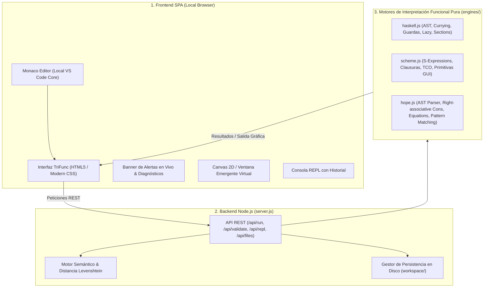

# 🚀 TriFunc Studio — Pure Functional IDE

<div align="center">


<p align="center">
  <b>Un entorno de desarrollo integrado (IDE) profesional, moderno y 100% desconectado, diseñado específicamente para la programación funcional pura en Haskell, Scheme y Hope.</b>
</p>

<p align="center">
  Desarrollado y Diseñado por <b>Nhyix</b>
</p>

</div>

---

## 🌟 Acerca del Proyecto

**TriFunc Studio** nace con el objetivo de democratizar la enseñanza, exploración e investigación del **paradigma funcional puro**, eliminando por completo la fricción de instalar complejas cadenas de compilación (como compiladores pesados de GHC o binarios históricos de los años 80 que ya no compilan en sistemas operativos modernos) y abriendo la "caja negra" de la reducción funcional mediante la inspección algebraica paso a paso.

El IDE reúne tres lenguajes fundamentales en la evolución del paradigma declarativo:
- 🔵 **Haskell (1990)**: El estándar moderno de la programación funcional pura con tipado estático avanzado, currificación automática, evaluación perezosa (*lazy evaluation*), guardas y secciones de operadores.
- 🟢 **Scheme (R7RS-small)**: El dialecto minimalista y elegante de Lisp con evaluación de expresiones S, clausuras léxicas de primer orden y optimización estricta de llamadas de cola (**TCO**).
- 🟣 **Hope (1978/1980s)**: El histórico e influyente lenguaje funcional puro creado en la Universidad de Edimburgo por Rod Burstall, David MacQueen y Donald Sannella. Precursor directo de Miranda, ML y Haskell, introdujo el primer sistema formal de *pattern matching* en ecuaciones (`---`), listas algebraicas con constructor cons `::` de asociatividad derecha y tipos polimórficos (`data`, `type`).

---

## ⚡ Características Principales

### 1. 🛡️ 100% Offline y Autónomo
- Todo el entorno (incluyendo **Monaco Editor**, iconos de **FontAwesome**, fuentes y estilos) se sirve localmente desde el servidor integrado.
- No realiza ninguna petición a internet ni depende de CDNs en la nube. Funciona en aviones, redes privadas o aulas sin conexión.

### 2. 🧠 Linter Inteligente con Corrección de Errores Tipográficos (Levenshtein)
- Analizador semántico en tiempo real con *debounce* de 400ms.
- Cuando detecta un identificador no reconocido, calcula la **Distancia de Levenshtein** ($\text{lev} \le 2$) contra la tabla de símbolos y primitivas.
- Si detecta un error de escritura (ej. `subttoal`), despliega un banner de advertencia superior con un botón **Quick-Fix** que corrige el código con un solo clic.

### 3. 🪄 Detección Automática Heurística de Lenguaje
- Inspecciona patrones sintácticos en vivo (presencia de `(define ...)` para Scheme, `dec` y `---` para Hope, o signaturas `::` y guardas `|` para Haskell).
- Muestra el porcentaje de confianza en la barra de navegación y conmuta el resaltado sintáctico de Monaco automáticamente.

### 4. 🔬 Traza de Reducciones Paso a Paso ($\beta$-reducción)
- Visualiza la secuencia completa de sustituciones algebraicas y llamadas recursivas para entender exactamente cómo se resuelve cada expresión.

### 5. 💬 REPL Interactivo con Estado
- Consola de evaluación inmediata (*Read-Eval-Print Loop*) para experimentar con funciones y expresiones al vuelo sin recompilar todo el archivo.

### 6. 🎨 Subsistema Gráfico 2D y Ventanas Virtuales
- Soporte para dibujar primitivas geométricas (`draw-circle`, `draw-line`, `clear-canvas`) y renderizado de imágenes dentro de un lienzo funcional inmutable o en una ventana emergente virtual (`msgbox`).

### 7. 🎛️ Personalización en Vivo y Accesibilidad
- Control deslizante de tamaño de fuente (`10px` a `28px`).
- Selector de color de texto con paleta de colores neón y selector hexadecimal.
- 5 temas visuales: *VS Modern Dark*, *Synthwave '84 (Neon Cyber)*, *Monokai Pro*, *GitHub Dark* y *Tema Claro*.

---

## 🏗️ Arquitectura Técnica



---

## 🚀 Requisitos e Instalación

### Prerrequisitos
- **Node.js** versión `16.0.0` o superior ([Descargar Node.js](https://nodejs.org/)).
- Navegador web moderno (Chrome, Edge, Firefox, Brave, Safari).

### Instalación Rápida

1. **Clonar el repositorio:**
   ```bash
   git clone https://github.com/Nhyix/prolog-compiler.git
   cd Compilator
   ```

2. **Instalar dependencias locales:**
   ```bash
   npm install
   ```

3. **Iniciar TriFunc Studio:**
   * **En Windows (Recomendado):** Haz doble clic en `run_ide.bat` o ejecuta en PowerShell:
     ```powershell
     .\run_ide.ps1
     ```
   * **Desde la terminal (Cualquier Sistema Operativo):**
     ```bash
     npm start
     ```

4. **Abrir en tu navegador:**
   Visita la URL:
   ```
   http://localhost:3333
   ```

---

## 📂 Estructura del Repositorio

```text
Compilator/
├── docs/                               # 📚 Documentación Técnica Detallada
│   ├── ARQUITECTURA_TRIFUNC_IDE.md     # Especificación arquitectónica y roadmap
│   ├── GUIA_EXPOSICION_IDE.md          # Guion maestro para presentaciones y exposiciones
│   └── TICKETS_FUNCIONALES.md          # Caso comparativo de ticket comercial en los 3 lenguajes
├── engines/                            # ⚙️ Motores Funcionales Propios
│   ├── haskell.js                      # Intérprete AST, currificación y evaluación de Haskell
│   ├── hope.js                         # Intérprete Hope 1978/1980 con pattern matching y tracer
│   └── scheme.js                       # Motor Scheme R7RS basado en BiwaScheme con TCO
├── examples/                           # 💡 Colección de Algoritmos Canónicos de Ejemplo
│   ├── haskell/                        # Factorial, quicksort, HOFs
│   ├── hope/                           # Factorial, fibonacci, árboles binarios (ADTs)
│   └── scheme/                         # Recursión, fibonacci, clausuras léxicas
├── public/                             # 🌐 Frontend del IDE (SPA)
│   ├── app.js                          # Lógica del cliente, linter, REPL, eventos
│   ├── index.html                      # Estructura principal y modales
│   ├── monaco-languages.js             # Definiciones sintácticas y tokenizadores para Monaco
│   └── style.css                       # Estilos modernos, temas y efectos visuales
├── workspace/                          # 📁 Espacio de Trabajo del Usuario
│   ├── main.hs                         # Plantilla base Haskell
│   ├── main.hop                        # Plantilla base Hope
│   ├── main.scm                        # Plantilla base Scheme
│   ├── ticket.hs                       # Caso de estudio comercial Haskell ($709.92)
│   ├── ticket.hop                      # Caso de estudio comercial Hope ($709.92)
│   └── ticket.scm                      # Caso de estudio comercial Scheme ($709.92)
├── .gitignore                          # Exclusión de node_modules, temporales y logs
├── package.json                        # Metadatos del proyecto y dependencias
├── README.md                           # Portada y manual principal del repositorio
├── run_ide.bat                         # Lanzador en 1 clic para Windows CMD
├── run_ide.ps1                         # Lanzador para Windows PowerShell
└── server.js                           # Servidor Express, API REST y sandbox de seguridad
```

---

## ⌨️ Atajos de Teclado

| Atajo | Acción |
|---|---|
| <kbd>Ctrl</kbd> + <kbd>Enter</kbd> | Ejecutar el código del archivo activo |
| <kbd>Shift</kbd> + <kbd>Alt</kbd> + <kbd>F</kbd> | Formatear código y corregir sangría automáticamente |
| <kbd>Ctrl</kbd> + <kbd>S</kbd> | Guardar cambios en el archivo activo |
| <kbd>Ctrl</kbd> + <kbd>Espacio</kbd> | Abrir autocompletado e IntelliSense contextual |
| <kbd>Flechas Arriba / Abajo</kbd> | Navegar por el historial de comandos en el REPL |

---


## 📄 Licencia y Reconocimientos

Este proyecto está bajo la Licencia **MIT**. Consulta el archivo `package.json` para más detalles.

* **Creador & Arquitecto:** **Nhyix**
* **Tecnologías Base:** [Node.js](https://nodejs.org/), [Express](https://expressjs.com/), [Monaco Editor](https://microsoft.github.io/monaco-editor/), [BiwaScheme](https://www.biwascheme.org/), [FontAwesome](https://fontawesome.com/).
