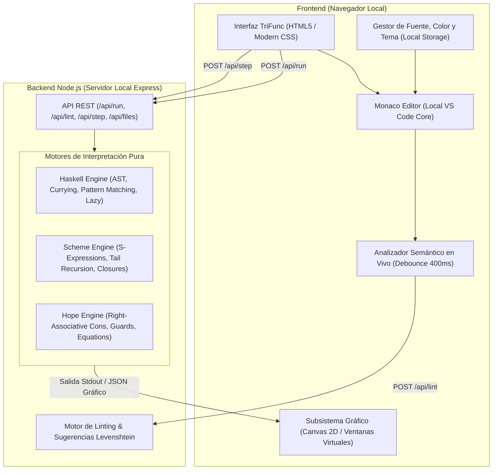

# Arquitectura, Construcción y Roadmap de TriFunc Studio IDE

> **TriFunc Studio** &bull; Entorno de Desarrollo Integrado Funcional Puro (Haskell &middot; Scheme &middot; Hope)  
> **Autor & Creador:** **Nhyix**  
> **ID de Verificación / Core:** `#7620859-NHYIX-CORE`  
> **Licencia:** MIT | 100% Offline Resilience

---

## 1. Visión General y Objetivos del Proyecto

El objetivo principal de TriFunc Studio es proporcionar una experiencia de desarrollo interactiva, pedagógica y completamente funcional para lenguajes funcionales puros sin requerir la instalación pesada de compiladores de sistema como GHC (Glasgow Haskell Compiler), Chez Scheme o herramientas heredadas de los años 80 como el compilador Hope de Edimburgo.

### Principios de Diseño Clave:
1. **100% Offline e Independiente:** No depende de APIs de terceros, servidores externos o CDNs en la nube. Todas las bibliotecas (Monaco Editor, fuentes, estilos) residen localmente.
2. **Pedagogía Funcional:** Inspección visual de reducciones paso a paso (\(\beta\)-reducción), REPL interactivo con estado inmutable, y soporte para evaluación perezosa (lazy evaluation) y estricta (strict evaluation).
3. **Capacidad Gráfica y de Ventanas:** Soporte para salida visual (Canvas 2D, primitivas geométricas, fractales y renderizado de imágenes) en un contexto funcional puro.
4. **Análisis Estático y Asistencia en Vivo:** Linter sintáctico y semántico en tiempo real con sugerencias de corrección ortográfica (Levenshtein) y *Quick-Fix*.

---

## 2. Diagrama de Arquitectura del Sistema



---

## 3. Componentes Principales del IDE

### 3.1. Frontend y Experiencia de Usuario (UI/UX)
- **Editor Monaco:** Núcleo de edición extraído de VS Code, adaptado para syntax highlighting de Scheme, Haskell y Hope.
- **Detección Automática de Lenguaje:** Detección de extensión de archivo (`.hs`, `.scm`, `.hop`) y análisis de patrones de código (`dec`, `define`, `::`, `->`) para conmutar automáticamente la sintaxis y sugerencias.
- **Barra de Herramientas y Personalización:**
  - Control de tamaño de fuente (`12px` - `24px`).
  - Paletas de color y contraste personalizadas para accesibilidad.
  - Selección de modo de ejecución (*Normal*, *Paso a Paso*, *REPL*).
- **Sub-ventana Gráfica y Canvas 2D:**
  - Sistema de primitivas puras (`rectangulo`, `circulo`, `linea`, `color`, `limpiar`, `imagen`).
  - El motor funcional evalúa una lista o tupla de comandos gráficos y los transfiere en formato estructurado JSON hacia el frontend para dibujado inmediato.

### 3.2. Servidor Backend (`server.js`)
Un servidor ligero en Express.js estructurado con endpoints modulares:
- `POST /api/run`: Recibe `{ code, language }`, orquesta la invocación del motor correspondiente con captura de `stdout` y timeout de seguridad contra ciclos infinitos.
- `POST /api/lint`: Analiza el código fuente en busca de errores sintácticos, variables indefinidas, palabras clave mal escritas y funciones no declaradas.
- `POST /api/step`: Ejecuta el paso a paso de reducción para mostrar las transformaciones algebraicas intermedias.
- `GET/POST /api/files`: Sistema de persistencia local en disco para guardar y abrir proyectos.

---

## 4. Ingeniería de los Motores Funcionales

Cada lenguaje cuenta con su propio lexer, parser y evaluador especializado:

### 4.1. Motor Haskell (`engines/haskell.js`)
- **Lexer y Parser:** Tokeniza operadores simbólicos (`.`, `$`, `::`, `->`, `\`, `|`), maneja secciones de operadores como `(* 1.16)` y lambdas con deconstrucción de tuplas (`\(_, precio, cant) -> ...`).
- **Pattern Matching & Ecuaciones Guardadas:** Soporte de sintaxis con guardas:
  ```haskell
  descuentoMayoreo t
    | t > 500   = t * 0.90
    | otherwise = t
  ```
- **Currificación Automática y Orden Superior:** Todas las funciones definidas aceptan aplicación parcial de argumentos. El operador de composición `.` (`(f . g) x = f (g x)`) y utilidades clave como `flip`, `id`, `fromIntegral` y `foldl` están integrados de forma nativa en el runtime.

### 4.2. Motor Scheme (`engines/scheme.js`)
- **Lector de Expresiones S:** Transforma secuencias de paréntesis en listas anidadas de JavaScript.
- **Evaluador de Entornos Léxicos:** Entornos anidados con soporte de clausuras (`closures`), `lambda`, `define`, `let`, `if` y macros básicas.
- **Optimización de Llamadas de Cola (TCO - Tail Call Optimization):** Permite recursión profunda sin desbordamiento de pila (*stack overflow*).
- **Tratamiento de Valores `#<undef>`:** Evita mostrar cadenas erróneas o `undefined` cuando se cargan definiciones sin efectos colaterales, mostrando mensajes limpios de confirmación de módulo.

### 4.3. Motor Hope (`engines/hope.js`)
- **Gramática y Precedencia:**
  - Implementación de asociatividad derecha estricta para el constructor de listas `::` (`parseCons`), permitiendo listas complejas como `(120,2) :: (80,3) :: (200,1) :: nil` sin anidamientos espurios.
  - Distinción estricta de aplicaciones yuxtapuestas frente a llamadas de constructor: `f x y` frente a `C(x, y)`.
- **Ecuaciones de Reescribimiento (`--- f pat <= exp;`):**
  - Motor de unificación de patrones contra tuplas y constructores `nil` / `head :: tail`.
  - Tipos sinónimos con la cláusula `type nombre == tipo;`.

---

## 5. El Linter Inteligente y Detección de Errores Tipográficos

El analizador semántico en `server.js` inspecciona el código antes de la ejecución:
1. **Extracción de Ámbito (Scope Analysis):** Identifica todas las declaraciones de funciones, tipos, parámetros y variables locales.
2. **Algoritmo de Distancia de Levenshtein:** Cuando se detecta un identificador desconocido, compara la palabra contra el diccionario de primitivas y variables en alcance:
   $$\text{lev}(a, b) \le 2$$
   Si la distancia es menor o igual a 2 caracteres o existe transposición/sustitución cercana, el IDE emite una advertencia de diagnóstico con la sugerencia correspondiente (e.g. `¿Quisiste decir 'subtotal'?`).
3. **Quick-Fix:** Marcadores de Monaco con soporte para sustitución en un solo clic.

---

## 6. Áreas de Mejora y Roadmap Futuro

A pesar de las capacidades actuales, se identifican las siguientes áreas de optimización para convertir a TriFunc Studio en un entorno de nivel de producción:

### 6.1. Compilación a WebAssembly (Wasm)
- **Estado Actual:** Los intérpretes son árboles de sintaxis abstracta (AST-walking interpreters) escritos en JavaScript ejecutados en Node.js.
- **Mejora:** Compilar compiladores reales (GHC Haskell vía GHC WebAssembly backend, GNU Guile o Chez Scheme a Wasm) para ejecutarse al 100% dentro del hilo del navegador sin necesidad de servidor backend Node.js.

### 6.2. Soporte Completo del Protocolo LSP (Language Server Protocol)
- **Estado Actual:** Linter personalizado mediante endpoints HTTP `/api/lint`.
- **Mejora:** Implementar un servidor LSP formal sobre WebSockets. Esto permitirá:
  - *Go to Definition* (ir a la definición de funciones y tipos).
  - *Find All References* (búsqueda de usos de símbolos).
  - *Rename Symbol* (refactorización segura de nombres).
  - Información de tipos en hover con inferencia Hindley-Milner completa.

### 6.3. Depurador Visual de Reducciones (Time-Travel Debugger)
- Representación en árbol interactivo (DOM/SVG) de las expresiones algebraicas.
- Capacidad de retroceder y avanzar paso a paso viendo exactamente qué regla de reescritura o qué patrón se activó en cada instante.

### 6.4. Sistema de Módulos e Importaciones
- Capacidad de incluir archivos externos (`import Data.List`, `(load "libreria.scm")`, `uses lists;`) dentro del explorador de archivos virtual del IDE.
- Soporte para paquetes de bibliotecas estándar funcionales completas.

### 6.5. Inferencia de Tipos Hindley-Milner Completa
- Inferencia y comprobación estricta de tipos estáticos en tiempo de edición tanto para Haskell como para Hope, detectando errores de tipos antes de la evaluación sin depender de anotaciones explícitas.
