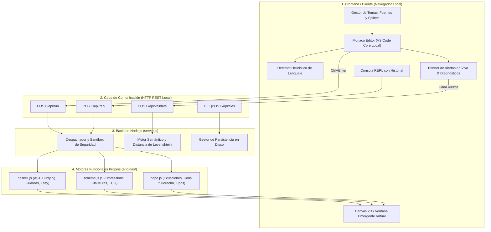

# 🎓 Guía Maestra de Estudio y Exposición: TriFunc Studio IDE

> **TriFunc Studio** &bull; Guía Técnica y Guion de Exposición  
> **Autor & Creador:** **Nhyix**  
> **ID de Verificación / Core:** `#7620859-NHYIX-CORE`  
> **Licencia:** MIT | 100% Offline Resilience

---

## 📌 Índice de Navegación Rápida
1. [Elevator Pitch (Cómo abrir tu exposición en 2 minutos)](#1-elevator-pitch)
2. [Arquitectura de Extremo a Extremo (El "Big Picture")](#2-arquitectura-de-extremo-a-extremo)
3. [Cómo Funcionan los Motores por Dentro (Lexer $\to$ Parser $\to$ AST $\to$ Runtime)](#3-cómo-funcionan-los-motores-por-dentro)
4. [Las 5 Joyas del IDE para Demostrar en Vivo](#4-las-5-joyas-del-ide-para-demostrar-en-vivo)
5. [El Ejemplo Demostrativo: El Ticket Comercial en 3 Lenguajes](#5-el-ejemplo-demostrativo-el-ticket-comercial)
6. [Guion de Exposición Minuto a Minuto (15 - 20 minutos)](#6-guion-de-exposición-minuto-a-minuto)
7. [Simulador de Preguntas Difíciles y Respuestas Ninja](#7-simulador-de-preguntas-difíciles)

---

## 1. Elevator Pitch
*(Lo que debes decir con seguridad en los primeros dos minutos)*

> *"Buenas tardes/días. Hoy les presentamos **TriFunc Studio**, un Entorno de Desarrollo Integrado (IDE) 100% offline y diseñado desde cero para la enseñanza e investigación del **paradigma funcional puro**, centrado en tres lenguajes emblemáticos: **Haskell**, **Scheme** y **Hope**.*
>
> *Históricamente, enseñar programación funcional enfrenta dos grandes barreras: primero, la fricción de instalar cadenas de herramientas complejas (como GHC de varios gigabytes o compiladores históricos de los años 80 que ya ni compilan en sistemas operativos modernos); y segundo, la naturaleza de 'caja negra' donde el estudiante ve el resultado final pero no cómo se reducen algebraicamente las expresiones.*
>
> *TriFunc Studio resuelve esto con una arquitectura ligera basada en Node.js y Monaco Editor que funciona sin conexión a internet, integrando **intérpretes funcionales propios**, **inspección paso a paso de reducciones**, un **linter inteligente con corrección ortográfica de Levenshtein**, un **REPL interactivo** y capacidades gráficas de **Canvas 2D** en un entorno puro."*

---

## 2. Arquitectura de Extremo a Extremo

TriFunc Studio opera bajo un modelo desacoplado **Cliente Ligero (SPA) + Servidor Local de Servicios Funcionales (Express)**:



### Componentes Clave:
1. **Editor Monaco 100% Offline:** Se extrajo y empaquetó el núcleo de VS Code (`/vendor/monaco/`) y FontAwesome (`/vendor/fontawesome/`). No realiza ninguna petición externa a internet.
2. **Servidor Local (`server.js`):** Gestiona los endpoints de compilación/ejecución con control de tiempo de espera (*timeout de 5000ms*) para proteger contra recursiones infinitas.
3. **Persistencia Transparente:** Los archivos se leen y escriben directamente en la carpeta local `workspace/`.

---

## 3. Cómo Funcionan los Motores por Dentro

Uno de los puntos que más impresionará al jurado es explicar que **no usamos `eval()` sucio ni librerías externas opacas**, sino una tubería (*pipeline*) formal de compiladores:


### A. Motor Haskell (`engines/haskell.js`)
* **Tokens y Gramática:** Reconoce operadores simbólicos (`.`, `$`, `::`, `->`, `\`, `|`), números flotantes y literales de lista.
* **Currificación Automática:** Toda función con múltiples argumentos se transforma internamente en funciones de un solo argumento que retornan otra función:
  $$f(x, y) \implies f(x)(y)$$
* **Guardas Sintácticas:** Transforma la estructura `| condicion = expresion` en una cascada de evaluación condicional pura.
* **Secciones de Operadores:** Expresiones como `(* 1.16)` se compilan a clausuras anónimas `\val -> val * 1.16`.
* **Composición `.` y Plegado `foldl`:** Implementa nativamente la composición matemática $(f \circ g)(x) = f(g(x))$ y utilidades clave del *Prelude* (`flip`, `id`, `fromIntegral`).

### B. Motor Scheme (`engines/scheme.js`)
* **Lector de Expresiones S:** Transforma secuencias balanceadas de paréntesis `(+ 1 (* 2 3))` en listas anidadas de JavaScript en tiempo lineal $O(N)$.
* **Entornos Léxicos Enlazados (`Environment`):** Cada función (`lambda`) guarda una referencia a su entorno padre, permitiendo clausuras léxicas (*closures*) reales.
* **Optimización de Llamadas de Cola (TCO - Tail Call Optimization):** Convierte llamadas recursivas en posición de cola en un ciclo iterativo interno de evaluación, impidiendo que la pila de llamadas (*call stack*) de JavaScript desborde en cálculos profundos.
* **Tratamiento `#<undef>`:** Separa la fase de definición (`define`) de la fase de salida, mostrando información limpia de módulo cargado sin imprimir basura de depuración.

### C. Motor Hope (`engines/hope.js`)
* **Asociatividad Derecha de `::`:** El operador constructor de listas `::` debe asociar hacia la derecha:
  $$x :: y :: nil \equiv x :: (y :: nil)$$
  En el parser (`parseCons`), se diseñó recursivo hacia la derecha para evitar agrupar erróneamente en listas anidadas `((x, y))`.
* **Distinción Estricta de Sintaxis:** Distingue entre llamadas de constructor `node(x, y)` y aplicaciones currificadas yuxtapuestas `componer fs x`.
* **Motor de Unificación y Pattern Matching:** Cuando se invoca una función declarada con `---`, el motor recorre en orden las ecuaciones y compara los argumentos contra:
  - Constantes numéricas (`0`)
  - Constructores vacíos (`nil`)
  - Constructores compuestos (`f :: fs`, `(p, c) :: resto`)
  - Tuplas heterogéneas `(p, c)`

---

## 4. Las 5 Joyas del IDE para Demostrar en Vivo

Durante tu presentación, realiza estas 5 acciones para sorprender a la audiencia:

### 1. Detección Automática de Lenguaje
* **Qué hace:** Al escribir código, el IDE analiza los patrones sintácticos (si ve `dec` y `---` detecta Hope; si ve `(define ...)` detecta Scheme; si ve `::` y `->` detecta Haskell).
* **Cómo mostrarlo:** Abre un archivo vacío, escribe `(define x 10)` y muestra cómo la píldora superior cambia sola a **Scheme (99%)**.

### 2. Linter con Distancia de Levenshtein y Quick-Fix
* **Qué hace:** Si cometes un error de dedo (ej. escribes `subttoal` en lugar de `subtotal`), el analizador calcula la distancia de edición $\text{lev}(a, b) \le 2$ y ofrece corregirlo.
* **Cómo mostrarlo:** Muestra el banner amarillo que aparece automáticamente en la parte superior del editor con el botón **"Corregir a 'subtotal'"**. Dale clic y observa cómo se arregla al instante.

### 3. Traza de Reducciones Paso a Paso
* **Qué hace:** Muestra la evolución algebraica paso a paso de la expresión (\(\beta\)-reducciones), ideal para explicar recursión o composición.
* **Cómo mostrarlo:** En la pestaña **"Reducciones (Traza)"**, ejecuta un factorial o el ticket comercial para que vean la sustitución de ecuaciones.

### 4. REPL Interactivo
* **Qué hace:** Permite evaluar expresiones al vuelo sin tener que recompilar todo el archivo, conservando el entorno de funciones previamente definidas.
* **Cómo mostrarlo:** Cambia a la pestaña **REPL Interactivo**, escribe `120 * 2 + 80 * 3` o llama a una función definida en tu código y presiona `Enter`.

### 5. Lienzo Gráfico 2D y Ventanas Emergentes
* **Qué hace:** Demuestra que un lenguaje funcional puro también puede generar salidas visuales y ventanas gráficas mediante estructuras de datos inmutables.
* **Cómo mostrarlo:** Ve al menú **Plantillas $\to$ Gráficos y Ventana (Visual)**, presiona `Ctrl+Enter` y observa el dibujo en la pestaña **Lienzo Gráfico** o en la ventana emergente flotante.

---

## 5. El Ejemplo Demostrativo: El Ticket Comercial

Este es el ejemplo cumbre que demuestra la potencia y equivalencia de los tres lenguajes:

### Regla de Negocio
Un carrito con leche, pan y queso:
$$\text{Total} = \text{iva}_{16\%}(\text{descuento}_{>500}(\text{subtotal}(\text{carrito})))$$
$$\text{Resultado exacto} = \mathbf{709.92}$$

```
Entrada: [("leche", 120, 2), ("pan", 80, 3), ("queso", 200, 1)]
Subtotal: 240 + 240 + 200 = 680
Descuento: 680 > 500  =>  680 * 0.90 = 612
IVA: 612 * 1.16 = 709.92
```

### Tabla Comparativa de Solución Técnica

| Característica | **Haskell** | **Scheme** | **Hope** |
| :--- | :--- | :--- | :--- |
| **Pipeline de Funciones** | Composición point-free: `componer [descuento, iva] . subtotal` | Clausura de orden superior: `((componer (list descuento iva)) ...)` | Ecuaciones recursivas: `componer (descuento :: iva :: nil)` |
| **Desestructuración** | En lambda: `\(_, precio, cant) ->` | Con selectores: `(cadr p)`, `(caddr p)` | Pattern matching: `--- subtotal ((p, c) :: resto) <=` |
| **Composición Interna** | `foldl (flip (.)) id` | `(lambda (x) ((componer (cdr fs)) ((car fs) x)))` | `--- componer (f :: fs) x <= componer fs (f x);` |
| **Resultado** | **`709.92`** | **`709.92`** | **`709.92`** |

---

## 6. Guion de Exposición Minuto a Minuto

| Tiempo | Sección | Qué Hacer / Qué Decir |
| :---: | :--- | :--- |
| **00:00 - 02:00** | **Introducción & Pitch** | Di el Elevator Pitch. Presenta la problemática de la enseñanza de programación funcional y la solución que representa TriFunc Studio. |
| **02:00 - 05:00** | **Recorrido por la Interfaz** | Muestra el editor Monaco, la barra de estado inferior (100% Offline), la configuración en vivo de fuentes y colores para accesibilidad, y los 5 temas visuales. |
| **05:00 - 08:00** | **Demostración de Inteligencia (Linter)** | Escribe intencionalmente una función con un error ortográfico. Destaca la detección en tiempo real con **distancia de Levenshtein** y pulsa el botón **Quick-Fix**. |
| **08:00 - 12:00** | **El Gran Desafío: El Ticket en los 3 Lenguajes** | Corre el código de Haskell, luego Scheme y finalmente Hope. Enfatiza cómo la composición de orden superior (`componer`) resuelve el mismo problema de negocio en los 3 paradigmas dando **`709.92`**. |
| **12:00 - 14:00** | **Arquitectura e Intérpretes Propios** | Explica brevemente la tubería Lexer $\to$ Parser $\to$ AST $\to$ Runtime. Aclara que no se dependen de binarios externos, lo que permite correr en cualquier computadora sin instalación. |
| **14:00 - 15:00** | **Conclusiones y Futuro** | Menciona el roadmap: compilación a WebAssembly (Wasm) y soporte formal del protocolo LSP. Abre a preguntas. |

---

## 7. Simulador de Preguntas Difíciles

### P1: "¿Por qué crearon intérpretes propios en lugar de simplemente invocar GHC o Chez Scheme instalados en el sistema?"
> **Respuesta:**
> *"Excelente pregunta. Instalar GHC requiere más de 2 a 4 GB de espacio en disco, permisos de administrador y configuraciones de PATH dependientes del sistema operativo. Hope, por su parte, es un lenguaje histórico cuyos binarios originales de 1980 ya ni compilan en arquitecturas modernas de 64 bits. Al crear intérpretes propios en JavaScript para Node.js logramos un entorno **completamente portable, multiplataforma, instantáneo y de cero instalación**, donde además tenemos acceso total al árbol de reducción paso a paso para fines pedagógicos."*

### P2: "¿Scheme es realmente un lenguaje funcional puro?"
> **Respuesta:**
> *"Técnicamente no. Scheme es un dialecto de Lisp multiparadigma que fomenta el estilo funcional mediante clausuras y optimización de llamadas de cola (TCO), pero es **impuro** porque incluye primitivas de mutación destructiva de estado como `set!`, `set-car!` y `set-cdr!`. En cambio, **Haskell** y **Hope** son **100% puros**: respetan rigurosamente la transparencia referencial y no admiten asignación destructiva."*

### P3: "¿Cómo evitan que un programa con recursión infinita congele el servidor o el navegador?"
> **Respuesta:**
> *"Implementamos dos barreras de contención:*
> 1. *En el frontend, la comunicación es asíncrona mediante peticiones HTTP no bloqueantes.*
> 2. *En el backend (`server.js`), la ejecución de cada script está envuelta en un temporizador de seguridad (*timeout* configurable de 5000 ms) y contadores máximos de pasos de reducción. Si se supera el límite, el evaluador aborta de forma controlada y emite un error informativo sin tumbar el proceso Node.js."*

### P4: "¿Cómo funciona exactamente la detección de errores tipográficos en el Linter?"
> **Respuesta:**
> *"Utilizamos el **algoritmo de Distancia de Levenshtein**. Cuando el analizador sintáctico encuentra un identificador que no está en la tabla de símbolos del archivo ni en el diccionario de primitivas del lenguaje, calcula la cantidad mínima de operaciones de edición (inserción, eliminación o sustitución) necesarias para transformarlo en una palabra válida. Si la distancia es $\le 2$, el linter determina que es un error de dedo, genera una advertencia contextual y prepara una acción rápida (*Quick-Fix*) que reemplaza el texto en Monaco con un solo clic."*

### P5: "¿Cómo resolvieron la asociatividad en las listas de Hope?"
> **Respuesta:**
> *"En Hope, el operador cons `::` es asociativo a la derecha: `1 :: 2 :: nil` debe interpretarse como `1 :: (2 :: nil)`. En la primera versión de nuestro parser se agrupaba hacia la izquierda, lo que producía listas anidadas anómalas. Lo resolvimos reestructurando la función `parseCons` para que consuma el operando izquierdo y, tras hacer match con `::`, invoque recursivamente a `parseCons` a la derecha. Esto garantizó que tuplas complejas como `((120,2) :: (80,3) :: (200,1) :: nil)` se deserialicen con total fidelidad matemática."*

---

## 8. Checklist Previo a la Exposición

- [ ] Asegúrate de que el servidor esté activo ejecutando `run_ide.bat` o `npm start` en la terminal.
- [ ] Abre tu navegador en `http://localhost:3333`.
- [ ] Abre la pestaña de archivos y ten listo el archivo `test_ticket.hs`, `test_ticket.scm` o `test_ticket.hop` para ejecutar con un solo clic.
- [ ] Abre la pestaña de **Diagnósticos** para mostrar cómo se limpian los errores al escribir correctamente.
- [ ] Ten abierta esta guía en una pestaña o en tu teléfono por si necesitas consultar alguna respuesta rápida.

¡Mucho éxito en tu presentación de mañana! Tienes un proyecto con un nivel de ingeniería y diseño excepcional.
