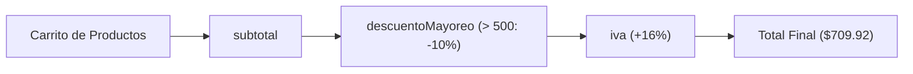

# Comparativa Funcional: Cálculo de Ticket de Venta en Haskell, Scheme y Hope

> **TriFunc Studio** &bull; Caso de Estudio Funcional Comparativo  
> **Autor & Creador:** **Nhyix**  
> **ID de Verificación / Core:** `#7620859-NHYIX-CORE`  
> **Licencia:** MIT | 100% Offline Resilience

---

## 1. Planteamiento del Problema Comercial

Se desea procesar un carrito de compras compuesto por una lista de productos. Cada producto cuenta con un precio unitario y una cantidad de unidades adquiridas:

$$\text{producto} = (\text{identificador}, \text{precio}, \text{cantidad})$$

La regla de negocio establece el siguiente flujo de procesamiento en canalización (*pipeline*):



1. **`subtotal`**: Suma el importe parcial de cada artículo:
   $$\text{subtotal} = \sum (\text{precio} \times \text{cantidad})$$
2. **`descuento` (Mayoreo)**: Si el subtotal supera \$500, se otorga un 10% de descuento (multiplicar por 0.90); en caso contrario, se mantiene el valor original:
   $$\text{descuento}(t) = \begin{cases} t \times 0.90 & \text{si } t > 500 \\ t & \text{en otro caso} \end{cases}$$
3. **`iva`**: Aplica el 16% de impuesto al valor agregado sobre el monto con descuento:
   $$\text{iva}(t) = t \times 1.16$$
4. **`componer` (Composición de orden superior)**: En lugar de anidar llamadas manualmente como `iva(descuento(subtotal(c)))`, se define una función general de composición que recibe una lista de funciones $[f_1, f_2, \dots, f_n]$ y las aplica sucesivamente de izquierda a derecha.
5. **Dato de prueba**:
   $$\text{carrito} = [(\text{"leche"}, 120, 2), (\text{"pan"}, 80, 3), (\text{"queso"}, 200, 1)]$$
   * Subtotal: $(120 \times 2) + (80 \times 3) + (200 \times 1) = 240 + 240 + 200 = \mathbf{680}$
   * Descuento: $680 > 500 \implies 680 \times 0.90 = \mathbf{612}$
   * IVA: $612 \times 1.16 = \mathbf{709.92}$

---

## 2. Versión en Haskell (`.hs`)

Haskell aborda el problema haciendo uso de **tipado estático fuerte**, **estilo libre de puntos (*point-free*)**, **secciones de operadores** y **guardas sintácticas**.

### Código Fuente

```haskell
type Producto = (String, Double, Int)

subtotal :: [Producto] -> Double
subtotal = sum . map (\(_, precio, cant) -> precio * fromIntegral cant)

descuentoMayoreo :: Double -> Double
descuentoMayoreo t
  | t > 500   = t * 0.90
  | otherwise = t

iva :: Double -> Double
iva = (* 1.16)

-- Compone una lista de funciones, aplicándolas de izquierda a derecha
componer :: [a -> a] -> a -> a
componer = foldl (flip (.)) id

total :: [Producto] -> Double
total = componer [descuentoMayoreo, iva] . subtotal

main = print (total [("leche", 120, 2), ("pan", 80, 3), ("queso", 200, 1)])
```

### Análisis Técnico Detallado

1. **Sinónimo de Tipo (`type Producto`)**:
   `type Producto = (String, Double, Int)` define una tupla de 3 elementos. Al ser un sinónimo (`type`), no agrega costo de envoltura en tiempo de ejecución.
2. **`subtotal` y Point-Free**:
   * `subtotal` no menciona explícitamente su parámetro (estilo *point-free*): se define como la composición `sum . map (...)`.
   * La función anónima `\(_, precio, cant) -> precio * fromIntegral cant` desestructura la tupla ignorando el nombre con `_`.
   * `fromIntegral` convierte el entero `Int` a un tipo numérico compatible con `Double`.
3. **Guardas (`|`)**:
   * En lugar de un `if-then-else`, Haskell permite expresar ramas condicionales matemáticas con la barra vertical `|`.
   * `otherwise` es simplemente un alias booleano para `True`.
4. **Sección de Operador (`(* 1.16)`)**:
   * Haskell permite aplicar parcialmente operadores binarios infijos: `(* 1.16)` es una función equivalente a `\x -> x * 1.16`.
5. **`componer` con `foldl`, `flip` y `id`**:
   * La función identidad `id x = x` sirve como elemento neutro inicial.
   * `(.)` compone dos funciones de derecha a izquierda: $(f \circ g)(x) = f(g(x))$.
   * Al invertir los argumentos con `flip (.)`, la composición se invierte: `(flip (.)) f g = g . f`, logrando que las transformaciones se ejecuten en el orden natural en que se escriben en la lista (primero descuento, luego IVA).

---

## 3. Versión en Scheme (`.scm`)

Scheme (familia Lisp) implementa el algoritmo con **evaluación estricta**, **código homoicónico basado en S-expressions** y **clausuras de primera clase**.

### Código Fuente

```scheme
(define (subtotal carrito)
  (apply + (map (lambda (p) (* (cadr p) (caddr p))) carrito)))

(define (descuento-mayoreo t)
  (if (> t 500) (* t 0.9) t))

(define (iva t) (* t 1.16))

;; Compone una lista de funciones, de izquierda a derecha
(define (componer fs)
  (lambda (x)
    (if (null? fs)
        x
        ((componer (cdr fs)) ((car fs) x)))))

(define (total carrito)
  ((componer (list descuento-mayoreo iva)) (subtotal carrito)))

(total '(("leche" 120 2) ("pan" 80 3) ("queso" 200 1)))
```

### Análisis Técnico Detallado

1. **`apply +` y `map`**:
   * `map` genera una lista con los subtotales individuales: `'(240 240 200)`.
   * `apply` "desempaqueta" dicha lista y se la pasa como argumentos a la función suma: `(+ 240 240 200)`.
2. **Acceso a elementos de lista (`cadr` y `caddr`)**:
   * En Scheme, cada producto es una lista `("leche" 120 2)`.
   * `(car p)` es el nombre `"leche"`.
   * `(cadr p)` es el segundo elemento (precio: `120`).
   * `(caddr p)` es el tercer elemento (cantidad: `2`).
3. **Clausura Léxica en `componer`**:
   * `componer` es una función de orden superior que **retorna una nueva función**: `(lambda (x) ...)`.
   * Esta función devuelta captura la lista `fs` en su entorno léxico.
   * Si `fs` está vacía (`null?`), devuelve `x` sin cambios.
   * En caso contrario, toma la primera función `(car fs)`, se la aplica a `x`, y pasa el resultado recursivamente al resto de las funciones `(componer (cdr fs))`.
4. **Llamada de Ejecución**:
   * La lista de entrada se introduce con la comilla de cita (*quote*): `'((...))`, lo que evita que el intérprete intente evaluar `"leche"` como función.

---

## 4. Versión en Hope (`.hop`)

Hope (creado en 1978 en la Universidad de Edimburgo) es el **primer lenguaje funcional con tipado polimórfico y pattern matching formal**, antecesor directo de Miranda, ML y Haskell.

### Código Fuente

```hope
type producto == num # num;      ! (precio, cantidad)

dec subtotal : list(producto) -> num;
--- subtotal nil <= 0;
--- subtotal ((p, c) :: resto) <= p * c + subtotal resto;

dec descuento : num -> num;
--- descuento t <= if t > 500 then t * 0.9 else t;

dec iva : num -> num;
--- iva t <= t * 1.16;

dec componer : list(alpha -> alpha) -> alpha -> alpha;
--- componer nil x <= x;
--- componer (f :: fs) x <= componer fs (f x);

dec total : list(producto) -> num;
--- total c <= componer (descuento :: iva :: nil) (subtotal c);

total ((120,2) :: (80,3) :: (200,1) :: nil);
```

### Análisis Técnico Detallado

1. **Declaración y Tipado Polimórfico**:
   * En Hope, cada función se introduce con una signatura formal `dec nombre : tipo;`.
   * Las variables de tipo genéricas se denotan con nombres griegos (`alpha`, `beta`). La signatura:
     $$\text{componer} : \text{list}(\alpha \to \alpha) \to \alpha \to \alpha$$
     indica que recibe una lista de funciones homogéneas y un valor inicial de tipo $\alpha$, devolviendo un resultado del mismo tipo.
2. **Definición por Ecuaciones (`---`) y Pattern Matching**:
   * No existen sentencias condicionales para examinar listas; la descomposición es puramente estructural mediante patrones en las ecuaciones:
     * Caso base: `--- subtotal nil <= 0;`
     * Caso inductivo: `--- subtotal ((p, c) :: resto) <= p * c + subtotal resto;`
   * El constructor cons `::` descompone simultáneamente la cabeza y la cola de la lista, y la tupla `(p, c)` extrae el precio y la cantidad en una sola regla.
3. **Currificación Nativa (*Currying*)**:
   * En `componer`, los parámetros se reciben por yuxtaposición:
     `componer nil x <= x;`
     `componer (f :: fs) x <= componer fs (f x);`
   * Si `componer` se invoca con un solo argumento (la lista de funciones), Hope produce automáticamente una clausura parcial que espera el valor numérico.
4. **Construcción de Listas con `nil`**:
   * A diferencia de los corchetes sintácticos modernos, en Hope clásico las listas se forman explícitamente mediante el operador infijo `::` terminado en el constructor vacío `nil`:
     `(120,2) :: (80,3) :: (200,1) :: nil`

---

## 5. Cuadro Comparativo de Paradigma y Características

| Característica | **Haskell** | **Scheme** | **Hope** |
| :--- | :--- | :--- | :--- |
| **Año de creación** | 1990 | 1975 | 1978 |
| **Pureza Funcional** | 100% Puro (Efectos vía mónadas `IO`) | Impuro (Permite mutación con `set!`) | 100% Puro |
| **Sistema de Tipos** | Estático, inferencia Hindley-Milner | Dinámico (*latente*) | Estático, polimórfico con variables de tipo |
| **Estrategia de Evaluación** | Perezosa (*Lazy evaluation*) | Ansiosa / Estricta (*Eager*) | Ansiosa / Estricta (*Call by value*) |
| **Desestructuración** | Pattern matching en argumentos y tuplas | Selectores de lista (`car`, `cadr`, `caddr`) | Pattern matching en ecuaciones (`::`, tuplas) |
| **Composición Funcional** | Operador infijo nativo `(.)` | Clausura recursiva explícita | Ecuaciones recursivas currificadas |
| **Manejo de Listas** | Sintaxis azucarada `[a, b, c]` y `(:)` | Listas de pares enlazados `'((...))` | Constructor infijo `::` con terminador `nil` |

---

## 6. Traza de Reducción Funcional Paso a Paso

El motor de TriFunc Studio registra el árbol de reducción paso a paso durante la ejecución del programa:

```text
#1  total([(120, 2), (80, 3), (200, 1)])
#2    -> subtotal([(120, 2), (80, 3), (200, 1)])
#3      -> 120 * 2 + subtotal([(80, 3), (200, 1)])
#4        -> 80 * 3 + subtotal([(200, 1)])
#5          -> 200 * 1 + subtotal([])
#6            -> 0
#7          -> subtotal acumulado = 240 + 240 + 200 = 680
#8  componer([descuento, iva], 680)
#9    -> descuento(680)  [680 > 500 => 680 * 0.90]  = 612
#10 componer([iva], 612)
#11   -> iva(612)        [612 * 1.16]               = 709.92
#12 componer([], 709.92)                            = 709.92
```

Tanto en Haskell, Scheme como en Hope, el valor resultante es idéntico: **`709.92`**, demostrando la equivalencia matemática y formal entre los tres enfoques del paradigma funcional.
